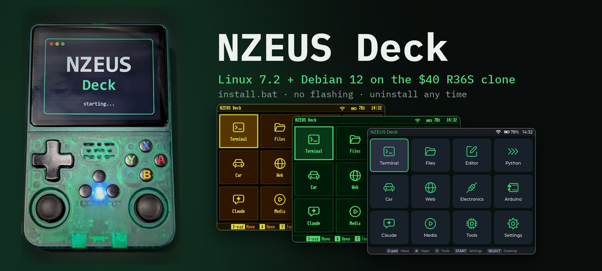
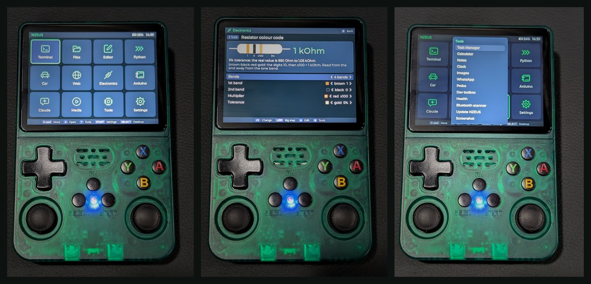
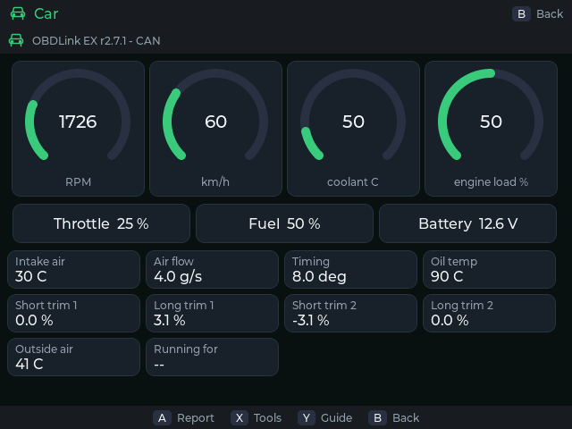
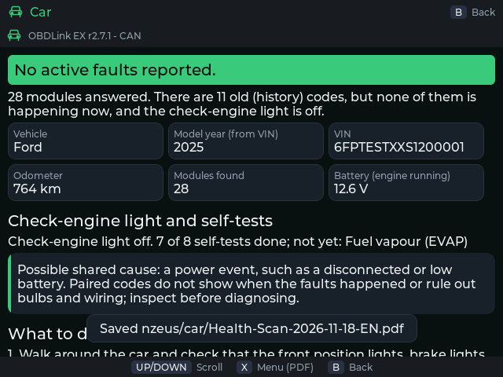
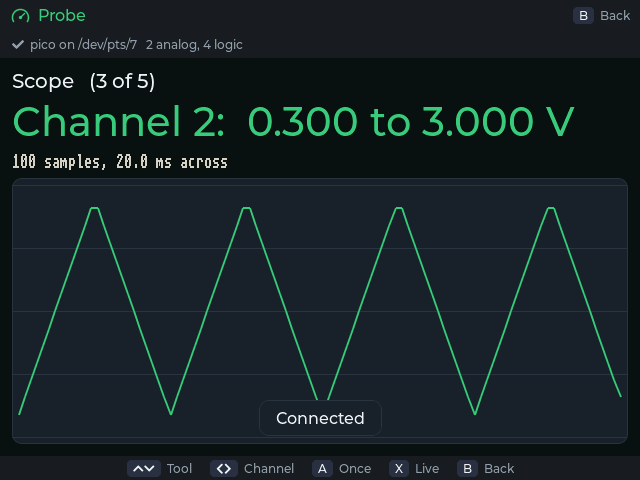
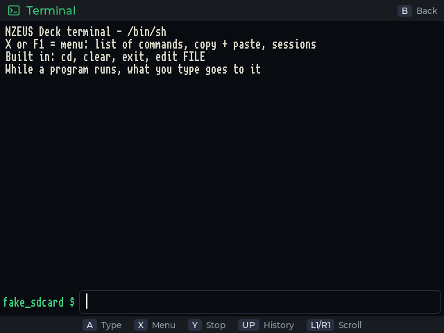
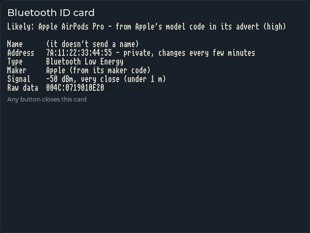
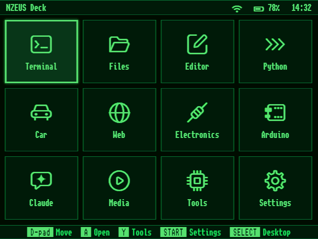

<p align="center"></p>

<p align="center">
  <a href="#install-in-3-steps-windows"></a>
  <a href="docs/WRITEUP.md"></a>
  <a href="#install-in-3-steps-windows"></a>
  <a href="LICENSE"></a>
</p>

# NZEUS Deck

**Turn the $40 R36S clone into a real Linux computer.** Linux 7.2 and Debian 12,
with a small desktop made for the console's screen and buttons: a real terminal
and Python, Wi-Fi and Bluetooth, and car and electronics tools.

This is the R36S that ArkOS and the other custom firmwares **can't** run on. Now it can.

## Install in 3 steps (Windows)

1. Download **[the latest release zip](../../releases/latest)** and unzip it.
2. Put the console's SD card in a card reader and double-click **`install.bat`**.
   Windows asks once for administrator rights.
3. Put the card back in the console and switch it on.

**Your games:** NZEUS needs about 5 GB free on the card. If the card is full,
`install.bat` offers to delete the games to make room. It asks first, and deleted
games don't come back, so copy them to your PC first if you want to keep them.

**Going back:** `uninstall.bat` brings the console's own system back. The console's
flash chip is never touched.

**Which console?** The R36S V2.7 clone with the HiChip E3100 chip (board marked
HC16E3100V20), in any colour. Most R36S consoles use a Rockchip chip and aren't
supported. Not sure? Run `install.bat` anyway: it only offers SD cards it
recognises as this console's, and changes nothing otherwise.

Mac and Linux steps, and what to do if the screen stays black:
[INSTALL.md](INSTALL.md).

## Gallery

<p align="center"></p>

| | |
|:-:|:-:|
| <br>Live car data (OBD-II) | <br>Car health report |
| <br>Oscilloscope (NZEUS Probe) | <br>Real Linux terminal |
| <br>Bluetooth "ID card" | <br>Green CRT theme |

## Features

### Apps

- **Everyday:** Terminal (on-screen keyboard, sessions, copy and paste), Files,
  Editor, Python 3, Notes, a web browser, Media (music), Images, Calculator, Clock
  (calendar, stopwatch, timer)
- **Connect:** Wi-Fi and Bluetooth (join networks, pair keyboards and mice, and
  scanners that show an "ID card" for each network or device), Claude and WhatsApp
  through your own PC or phone
- **Bench and car:** Car (live engine data, fault codes and readiness over an OBD-II
  adapter, and a PDF health report in English and Arabic), Electronics (resistor
  colour codes and other bench helpers), Arduino (USB serial), Probe (voltmeter,
  oscilloscope and I2C scanner with the NZEUS Probe board)
- **System:** a desktop mode with movable windows, 6 colour themes, mouse and
  keyboard support, Arabic text, Task manager, System health, Developer toolbox,
  screenshots and signed app updates

### Console and system

- **Boot:** Linux 7.2 starts from the SD card through the factory bootloader. The
  flash chip is never written.
- **Memory:** Debian 12 with about 117 MiB of usable RAM (the stock system sees
  about 42 MiB).
- **Hardware:** the console's own screen with correct colours, buttons, brightness,
  battery and charger readings, power-off and restart.
- **Sound:** speaker and headphones.
- **Connections:** USB networking and SSH from a PC, USB host mode (keyboards,
  sticks), and Wi-Fi with an RTL8821CU dongle.
- **Install:** `install.bat` puts the system on the console's own SD card as two
  image files, and `uninstall.bat` takes it off again.

### Not done yet

- Bluetooth audio and game controllers
- HDMI and sleep (both researched, not running yet)
- Games and emulators
- The upper 128 MiB of RAM ([how it works](docs/WRITEUP.md) explains why)

## More

- [How it works](docs/WRITEUP.md): the boot chain, the kernel port and the reverse
  engineering behind it
- [Test report](docs/TEST-REPORT-2026-11.md): what was tested, on the PC and on real
  consoles
- [Install guide](INSTALL.md): Windows, Mac and Linux steps, and what ends up on the
  card

Questions, or a console it doesn't recognise? [Open an issue](../../issues).

## Building (PC side)

Everything builds on a Windows PC in WSL Ubuntu, or on any Linux PC.

```bash
bash setup_lvgl.sh               # downloads LVGL 8.3.1
bash setup_test_tools.sh         # builds a PC copy of Dropbear for the tests
bash build_nzeus_gui.sh pc       # builds the Deck for the PC and runs its 709 checks
bash build_nzeus_modern.sh       # cross-builds the console program (mipsel)
bash linux-port/validate-board.sh
bash linux-port/build-experimental.sh   # kernel; needs the linux-hichip tree (below)
```

The kernel is [Siarhei Volkau's linux-hichip](https://github.com/SiarheiVolkau/linux-hichip)
(branch `hc16xx-7.2`, pinned in `linux-port/upstream-manifest.json`) plus the
board and driver work in `linux-port/`.

The factory bootloader only starts kernels wrapped with a key from the console's own
flash. That key **isn't in this repo**: the packaging tools read it from a NOR
backup of your own console. `linux-port/boot-analysis/` still needs adapting for a
backup other than the one it was developed with.

### Repo layout

| Folder | What it is |
|---|---|
| `apps/nzeus-gui/` | The Deck's apps (LVGL 8) and their PC tests |
| `apps/frontend-modern/` | The console program: screen, buttons, sound, battery |
| `apps/probe/`, `apps/bootlogo/` | NZEUS Probe board code, the power-on picture |
| `linux-port/` | The kernel and board port: device tree, drivers, USB networking, rescue shell, SD-card boot |
| `linux-port/rootfs/debian/` | Builds the Debian 12 (mipsel) system image, with a privacy scan |
| `linux-port/deck-modern/` | Helper programs the Deck calls (Wi-Fi join, Bluetooth, updates) |
| `installer/`, `tools/` | `install.bat` / `uninstall.bat`, signed app updates, release checks |

## Credits

- **Siarhei Volkau** (sf3k-hacking, linux-hichip): the HiChip HC16xx Linux work
  this port builds on
- **ozkaoz** (r36sx-hclinux): early HiChip console research
- Third-party code and fonts: [THIRD_PARTY.md](THIRD_PARTY.md)

## License

GPL-3.0-or-later for the Deck ([LICENSE](LICENSE)). Kernel and driver code is
GPL-2.0, like Linux. See [NOTICE](NOTICE).
Security issues: [SECURITY.md](SECURITY.md).
